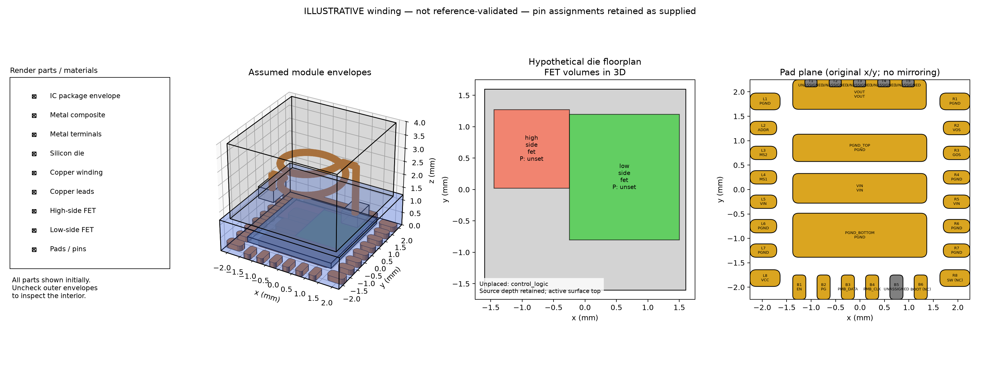
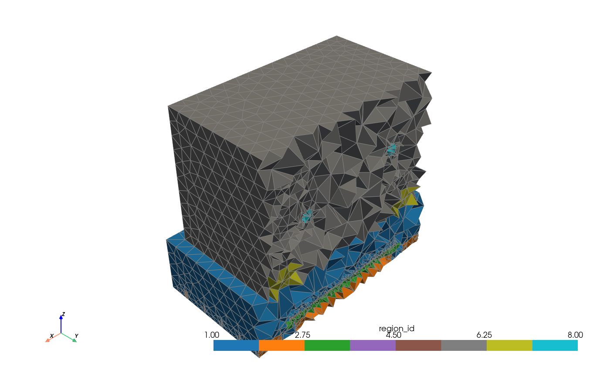
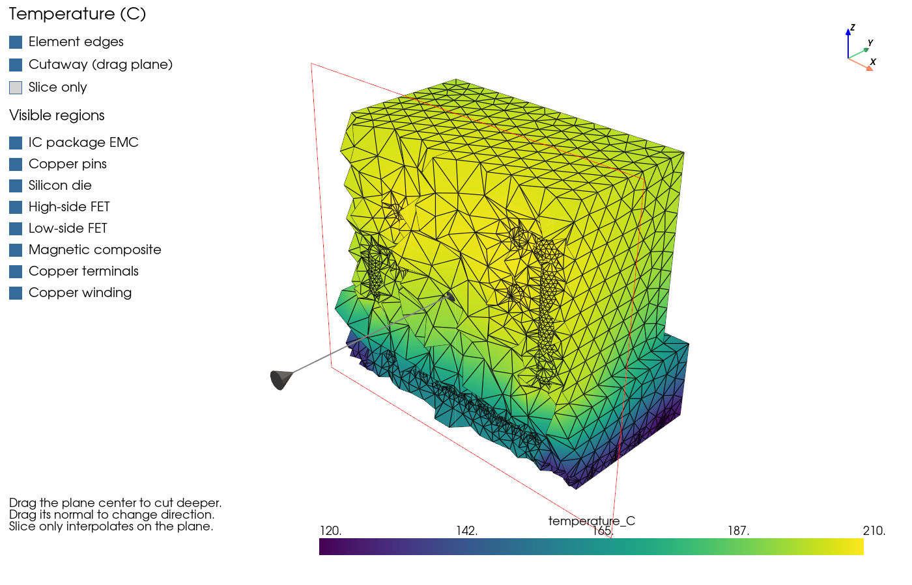
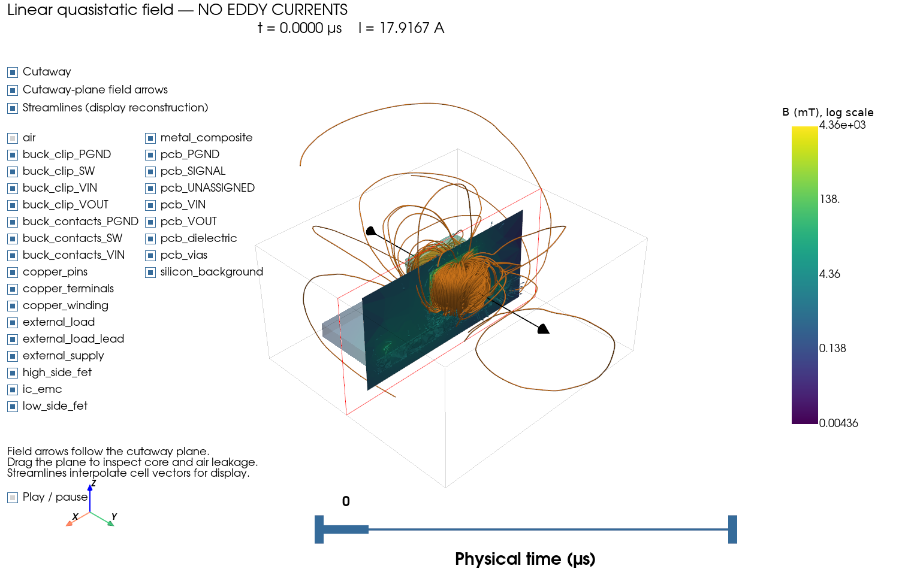

# CUDA Thermal & Electromagnetic Simulation for PoL DC–DC Modules

I developed this simulation workflow for a company project to study heat flow and magnetic fields in a point-of-load (PoL) buck converter with an integrated inductor. This repository presents my work in **power electronics modeling, CUDA C++, finite element methods, and engineering visualization**.

## What I built

- Parameterized 3D models of the package, silicon die, MOSFET regions, copper winding, terminals, and PCB assembly.
- Gmsh tetrahedral meshing with material and boundary assignments.
- Custom CUDA solvers for steady-state/transient temperature and linear magnetic fields.
- Python tools for loss estimation, cooling comparisons, result auditing, and interactive 3D field playback.

## 3D model



I built a parameterized module model with an integrated copper winding, magnetic composite, silicon die, MOSFET regions, and copper pins. Transparent package views expose the internal arrangement; internal geometry is illustrative.

## Meshing



I generated a conforming tetrahedral volume mesh with shared material interfaces and local refinement around small features. The cutaway shows the actual elements used for finite element analysis.

## Temperature distribution



The 3D temperature field reveals hot regions and heat flow through the winding, package, die, and pins.

The saved converged runs compare the same electrical operating conditions with air and equivalent top-surface liquid cooling:

| Predicted temperature | Air | Liquid |
| --- | ---: | ---: |
| Maximum top surface | 206.1 °C | 35.7 °C |
| Maximum silicon die | 165.7 °C | 117.7 °C |

Cooling the inductor top lowers internal temperatures, while the die remains warmer than the package surface. See the [air/liquid comparison plot](docs/assets/cooling-comparison.png).

**What CUDA solves:** the heat equation over the module's 3D mesh:

$$
\rho c_p\frac{\partial T}{\partial t}-\nabla\cdot(k\nabla T)=q
$$

Here, $T$ is temperature, $k$ is thermal conductivity, $\rho c_p$ is heat capacity per unit volume, and $q$ is generated heat per unit volume. Steady state sets the time derivative to zero.

MOSFET and winding conduction losses follow $P=I_{\mathrm{rms}}^2R(T)$, alongside switching and configured additional losses. Surface cooling follows $q''=h(T-T_{\mathrm{fluid}})$, with radiation and a lumped PCB heat path included. Liquid cooling uses an effective surface coefficient.

CUDA assembles linear tetrahedral finite elements and solves the sparse system in double precision using Jacobi-preconditioned conjugate gradients. Transient runs use implicit backward Euler. Iterations update temperature-dependent resistance and radiation; reports check convergence and heat balance.

## Magnetic field lines and EMI inspection



Orange streamlines show the magnetic field paths around the winding and PCB; the colored cutaway shows flux density. This view supports inspection of magnetic near-field leakage relevant to EMI. Streamlines interpolate the computed field for display; this is a quasistatic magnetic model, not a radiated-emissions prediction.

The full-module workflow computes distributed conductor currents for high-side and low-side switching states before solving their magnetic fields.

**What CUDA solves:** the magnetic vector potential $\mathbf A$:

$$
\nabla\times\left(\mu^{-1}\nabla\times\mathbf A\right)=\mathbf J,
\qquad \mathbf B=\nabla\times\mathbf A
$$

Here, $\mathbf J$ is current density, $\mu$ is magnetic permeability, and $\mathbf B$ is magnetic flux density. CUDA uses tetrahedral edge finite elements with gauge fixing and an iterative sparse solver. Python prepares conductor currents; field snapshots follow the ideal buck waveform, with $D=V_{\mathrm{out}}/V_{\mathrm{in}}$ and $\Delta I=V_{\mathrm{out}}(1-D)/(Lf_s)$.

## Scope and running

These are preliminary model predictions using assumed internal geometry and material/loss inputs; experimental validation and mesh convergence are not established. Magnetics assumes linear materials and excludes eddy currents, saturation, and hysteresis. Thermal losses are configured estimates rather than losses extracted from the magnetic solution.

Requires an NVIDIA CUDA GPU (compute capability 6.0+), CUDA toolkit, CMake, and `uv`. Copy `config.example.yaml` to local `config.yaml` and supply the missing geometry, material, and operating parameters; the public template is intentionally incomplete.

```sh
cmake -S . -B build -DCMAKE_CUDA_ARCHITECTURES=native
cmake --build build -j 2
./build/thermal --self-test
./build/em --self-test
uv run python/mesh.py
uv run python/thermal.py --compare
uv run python/em.py
uv run python/visualize.py output/thermal/temperature.vtu
uv run python/em_view.py output/em/magnetic.vtu --streamlines
```

Implementation: [thermal CUDA solver](src/thermal.cu), [magnetic CUDA solver](src/em.cu), and [Python modeling tools](python/).
